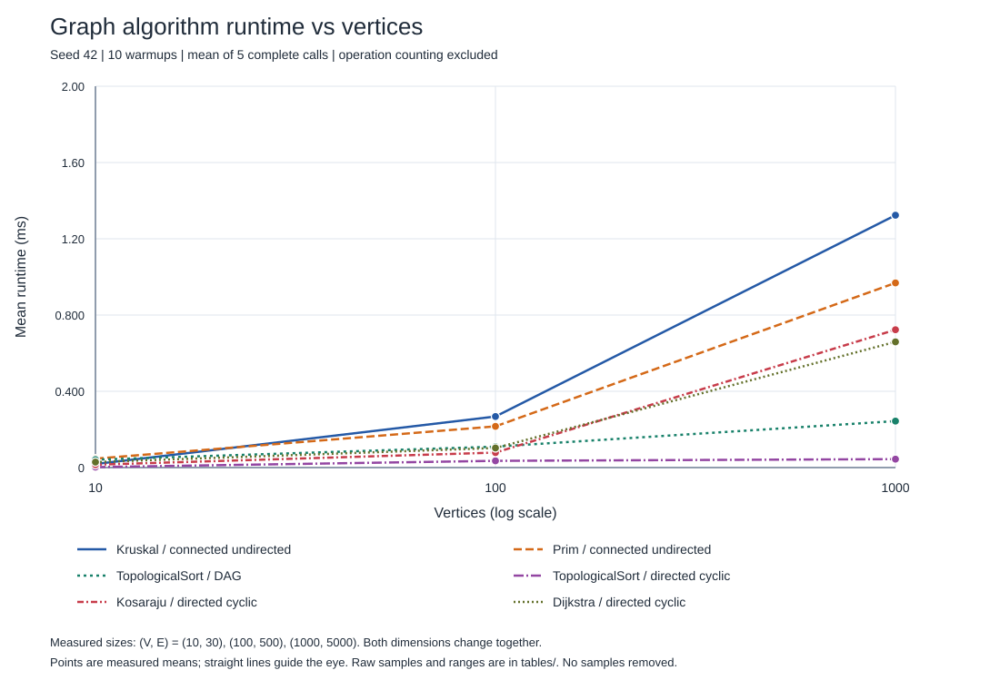
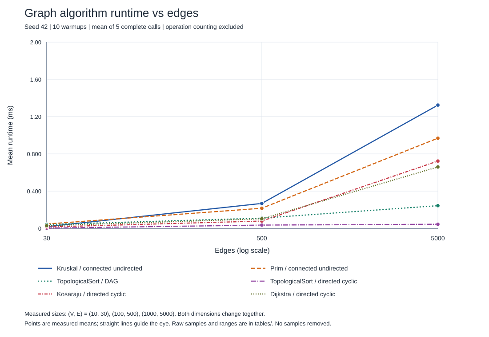

# Assignment 3

## Overview

This project uses graphs to connect city districts, check directed connections and find shortest routes. Vertices are districts, edges are roads, and weights are costs or distances.

To run it, open the project in IntelliJ IDEA with JDK 17 or newer and run `Main`. If IntelliJ does not recognize the source files, right-click `src` and select **Mark Directory as > Sources Root**.

| Program arguments | What it runs |
|---|---|
| Empty or `demo` | Small examples of the algorithms |
| `test` | All tests |
| `benchmark` | Experiments and new tables and plots |
| `all` | Everything above |

The project uses only the Java standard library.

## Implementation

`Graph` stores all edges and a neighbour list for each vertex. It supports directed and undirected graphs.

- **DSU:** `find` gets a group's root; `union` joins groups. It uses path compression and union by size.
- **Kruskal:** sorts edges and takes those connecting different DSU groups.
- **Prim:** uses `PriorityQueue` to add the cheapest edge to a new vertex.
- **Topological sort:** Kahn's algorithm processes vertices with no remaining incoming edges. Unprocessed vertices mean there is a cycle.
- **Kosaraju:** uses two DFS passes and reversed edges to find SCCs.
- **Dijkstra:** improves distances using a priority queue. Previous vertices are stored to reconstruct paths.

Kruskal and Prim return selected edges, total weight and connectivity. A disconnected graph gets a minimum spanning forest instead of one tree.

Totals use `long` to avoid overflowing `int`. Dijkstra returns infinity and an empty path for unreachable vertices.

Dijkstra rejects negative weights: a negative edge could improve a distance after a vertex was chosen as the closest. This breaks the algorithm's guarantee.

## Complexity Analysis

V means vertices and E means edges. The graph uses O(V + E) memory. The table shows additional memory.

| Algorithm | Time | Extra space |
|---|---|---|
| DSU initialization | O(V) | O(V) |
| DSU find / union | O(α(V)) amortized | O(V) for the DSU arrays |
| Kruskal | O(V + E log(E + 1)) | O(V + E) |
| Prim | O(V + E log(E + 1)) | O(V + E) |
| Topological sort | O(V + E) | O(V) |
| Kosaraju | O(V + E) | O(V + E) |
| Dijkstra | O(V + E log(E + 1)) | O(V + E) |

α(V) grows very slowly. DSU operations are almost constant time over many calls. Compression links visited nodes directly to their root. Union by size attaches the smaller tree to the larger one.

Kruskal sorts edges. Prim and Dijkstra use binary heaps with up to O(E) entries, including old entries that are skipped. For simple connected graphs, their time bounds are commonly written as O(E log V).

Topological sort and Kosaraju make a constant number of passes. More vertices need larger arrays; more edges need more scans, sorting or queue work. Reconstructing a path of L vertices takes O(L) time and space.

## Experimental Setup

| Size | Vertices | Edges |
|---|---:|---:|
| Small | 10 | 30 |
| Medium | 100 | 500 |
| Large | 1000 | 5000 |

Graphs use seed **42**, weights **1–100**, and no duplicate edges or self-loops.

- **MST graphs:** build an undirected tree, then add edges. This guarantees connectivity.
- **DAGs:** add edges only from smaller to larger vertex numbers, preventing cycles.
- **Cyclic graphs:** start with `0 -> 1 -> 2 -> 0`, then add edges. Full reachability is not guaranteed.

Kruskal and Prim share the undirected graph. Topological sort uses both directed types. Kosaraju and Dijkstra use the cyclic graph, with Dijkstra starting at 0.

Each case uses 10 warmup runs and **5 timed runs** with `System.nanoTime()` on the same graph. The average is the sum divided by five. Generation and file writing are outside the timing.

Operations are counted separately. There are **18 cases and 90 timed runs**. The environment was Java 21 on Windows 11.

## Results

Average time in **milliseconds**:

| Algorithm | 10 vertices | 100 vertices | 1000 vertices |
|---|---:|---:|---:|
| Kruskal | 0.018740 | 0.267820 | 1.323560 |
| Prim | 0.046740 | 0.216080 | 0.968540 |
| Topological sort: DAG | 0.041480 | 0.109700 | 0.243740 |
| Topological sort: cyclic | 0.002460 | 0.035280 | 0.044200 |
| Kosaraju | 0.014980 | 0.078540 | 0.722840 |
| Dijkstra | 0.028800 | 0.102620 | 0.659300 |

Number of checked edges:

| Algorithm | 10 vertices | 100 vertices | 1000 vertices |
|---|---:|---:|---:|
| Kruskal | 14 | 164 | 3356 |
| Prim | 60 | 1000 | 10000 |
| Topological sort: DAG | 60 | 1000 | 10000 |
| Topological sort: cyclic | 30 | 500 | 5054 |
| Kosaraju | 90 | 1500 | 15000 |
| Dijkstra | 60 | 1000 | 9946 |

Edge checks count iterations through edge lists. Prim checks both directions. Dijkstra also checks weights. Comparisons, DSU calls, queue operations and distance updates are separate counters.

Full counters and averages: [summary.csv](results/tables/summary.csv). Individual times: [runs.csv](results/tables/runs.csv).

Plots show average times with logarithmic horizontal axes. V and E grow together, so their effects are not measured separately.

## Comparison and Discussion

**Kruskal and Prim:** both give the same MST weight. Kruskal was faster on the small graph; Prim was faster on the other two. On the large graph, Kruskal made 50,369 sorting comparisons and Prim made 110,958 heap comparisons. More comparisons did not mean more time because sorting and heap operations involve different work.

**DSU:** large-graph Kruskal made 6712 find calls and 3356 union calls. Compression and union by size keep searches short. A test checks that repeated lookup uses a shorter path after compression.

**Kosaraju:** time grew with graph size. Edge checks were 90, 1500 and 15,000: exactly 3E for two DFS passes and reversing edges, matching O(V + E) work.

**Topological sort:** DAGs process all vertices. The two smaller cyclic graphs had no zero-indegree vertex, so they stopped after counting incoming edges. This explains their shorter times.

**Dijkstra:** time grew from 0.028800 to 0.659300 ms. Distance-update attempts grew from 30 to 500 to 4946. Larger graphs caused more edge and queue work.

Five runs are a small sample. Java and background programs affect timings, so these results do not give a universal winner.

## Testing

Run `Main` with the argument `test`. There are **26 correctness cases and 46 generator cases**, and all passed.

Tests cover small, disconnected and cyclic graphs, equal weights, multiple MSTs, unreachable vertices and one vertex. Extra checks include zero weights, large sums and negative-weight rejection.

- MST: correct weights, matching Kruskal/Prim results and no cycles.
- Topological sort: every edge goes forward; cycles are detected.
- SCC: correct groups, with each vertex appearing once.
- Dijkstra: correct distances and paths.
- Generators: correct sizes, connectivity, cycles and repeatability.

## Conclusion

Kruskal and Prim find cheap construction networks. Topological sort orders dependencies, Kosaraju finds mutually reachable groups, and Dijkstra finds shortest routes with nonnegative weights.

All tests passed. To repeat experiments, run `Main benchmark`. It replaces the result files; update the README tables before submitting new measurements.
